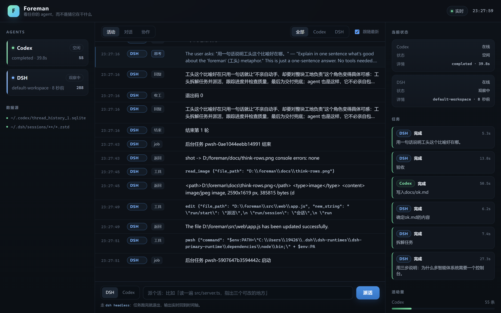
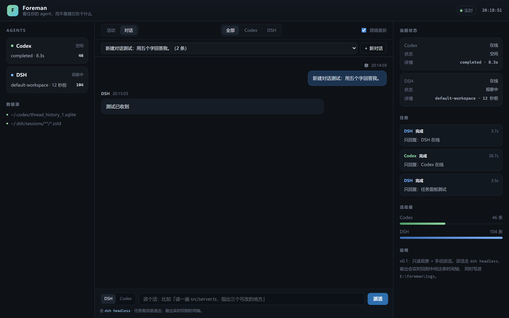
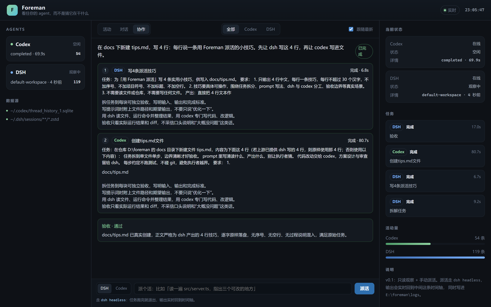

# Foreman · 让多个 AI Agent 一起干活的值班台

同时用 Codex 和 DeepSeek Harness 时，你会发现真正难的从来不是"它会不会写代码"，而是：

- 跑去倒杯水，回来发现它卡在等权限，而你完全不知道；
- A 说"改好了"，B 不知道改了哪个文件、为什么这么改；
- 两个 agent 同时动同一个仓库，冲突没人管；
- 出了问题，没有一条时间线可以复盘。

**Foreman 是一块值班台**：把两个 agent 的动作拉到同一条时间轴上，能看、能派活、能排队接力，还能在它们交活之后自动验收。

不是再造一个 agent，而是让一堆 agent 不打架。

## 截图

**活动流**：两个 agent 的动作按真实时间并排，思考单独上色。



**对话**：同一个对话里可以交替问 Codex 和 DSH，各有各的上下文，思考过程可展开。



**协作**：一句任务拆成多步，两个 agent 接力，最后自动验收；不过就带着问题返工一次。



## 现在能做什么

| 能力 | 说明 |
| --- | --- |
| 只读观察 | 读 Codex 的 SQLite 和 DSH 的 zstd 会话日志，不改它们 |
| 手动派活 | 选 agent、写一句话，起 `dsh headless` / `codex exec` 子进程 |
| 多轮对话 | 每条消息带 `sessionId` / `thread_id` 续会话，不是靠复述历史 |
| 协作链路 | 一个任务自动拆成 2–3 步，DSH 出方案、Codex 落文件，逐步交接 |
| 验收 + 返工 | 全部跑完后由 dsh 对照原始任务检查，不过就把问题写回步骤 prompt 重跑一次 |
| 随时接管 | 运行中可「停」，失败/停止的步骤可「重跑这一步」，单步 150 秒硬超时 |
| 全程落盘 | 事件按天写 JSONL，线程与任务链存 JSON，可回放、可统计 |

## 快速开始

需要 Node 24（直接跑 `.ts`，零依赖，不用 `npm install`）：

```powershell
node src/server.ts
# foreman  listening  http://127.0.0.1:4319
```

打开浏览器即可。页面上能看的东西不需要任何配置；**要派活**才需要两样东西：

1. **DSH**：`~/.foreman/env.json` 里放 key（这个文件不会进仓库、不进日志）

   ```json
   { "DEEPSEEK_API_KEY": "sk-..." }
   ```

2. **Codex**：桌面版自带的 CLI 会被自动探测
   （`%LOCALAPPDATA%\OpenAI\Codex\bin\<hash>\codex.exe`，读的是同一份 `~/.codex/config.toml`）。
   也可以用环境变量 `FOREMAN_CODEX_EXE` 指定。

工作目录默认 `D:\foreman`，可用 `FOREMAN_CWD` 改。

## 架构

```
浏览器（三栏，原生 HTML/CSS/JS，无构建）
   ▲ SSE：init / events / runs / chat-delta / chat-think / orch
   │
src/server.ts ── adapters/codex.ts   （node:sqlite 只读）
   │         ├── adapters/dsh.ts     （扫 zstd 帧，逐帧解压）
   │         ├── runner.ts           （spawn + 事件归一 + 150s 超时）
   │         ├── orchestrator.ts     （拆解 / 校验 / 任务链存档）
   │         ├── threads.ts          （多轮对话 + 会话 id）
   │         └── logs.ts             （按天追加 JSONL）
   ▼
E:\foreman\logs  （events-*.jsonl / threads/ / orchestrations/）
```

两边记录格式完全不同（一个是 SQLite，一个是逐帧 zstd 追加），适配器把它们归一成同一种事件：

```ts
type AgentEvent = { agent: "codex" | "dsh"; ts: number; kind: string; text: string };
```

于是时间轴能按真实时间把两边并排，而不是各看各的窗口。

## 三个刻意的取舍

**1. 只读优先，能不碰就不碰。**
观察走的是 agent 自己的落盘记录；派活走官方命令行（`dsh headless --json`、`codex exec --json`），
不去逆它们的私有 IPC，也不假装自己是第二个客户端。这样升级不会崩。

**2. headless 是无状态的，所以会话 id 必须落地。**
`dsh headless` 每次都是新会话，`--session-id` 才能续。线程里存 `sessions: { dsh, codex }`，
下一轮直接带上，上下文由 agent 自己维护——比把历史塞进 prompt 稳。

**3. 自动返工只做一次。**
验收失败就带着问题重跑，但只重跑一次。否则两个模型会互相觉得对方没做对，无限踢皮球。

## 已知限制

- **Codex 没有思考过程**：`codex exec --json` 的 `reasoning` 条目通常不带正文，只能看到"在想"这个动作；
- **单机、无鉴权**：只监听 `127.0.0.1`，没有登录，别直接暴露到公网；
- **Windows 优先**：路径、进程启动、Edge 截图脚本都按 Windows 写的，其他平台需要改；
- **验收依赖模型判断**：它不是编译器，能挡住"文件没写""正文里混了过程说明"，拦不住细微逻辑错误。

## 目录

```
src/
  server.ts         HTTP + SSE + 路由 + 任务编排
  runner.ts         起进程、解析事件、超时
  orchestrator.ts   拆解 / 校验解析 / 任务链
  threads.ts        对话与上下文
  logs.ts           落盘
  adapters/         codex.ts · dsh.ts · text.ts
  web/              index.html · style.css · app.js
scripts/            probe.ts · shot.mjs · check-*.mjs
```

## Roadmap

- [ ] 产物面板：步骤产出散在卡片里，改成文件树 + diff
- [ ] 任务历史：`/api/orchs` 有数据，界面还没有入口
- [ ] 状态细化：步骤跑完到验收之间应显示「验收中」，而不是先「完成」
- [ ] 被手动停止的 run 在任务面板里应显示「已停止」而不是「失败」

## License

MIT

## 验收中状态与任务历史（v0.8）

- 步骤跑完后链会先进「验收中」（紫色脉冲徽章），验收跑完才落到「已完成 / 失败」，
  不再是以前那种「先显示已完成、十几秒后才冒出验收结论」。
- 验收期间也能点「停」：会把验收进程一起杀掉，链标记「已停止」，不会触发自动返工。
- 协作视图顶部多了任务链下拉：列出最近 12 条（标题 · 状态 · 步数），可以回看任意一条；
  点「最新」回到最新那条并继续跟随新任务。
- 服务重启时，上次遗留的「拆解中 / 执行中 / 验收中」会被标成「已停止 · 服务重启，已中断」——
  进程已经没了，就不装作还在跑。

验证脚本：

```
node scripts/shot-verify.mjs        # 等「验收中」徽章出现再截图
node scripts/check-history.mjs      # 断言下拉条数、切换、回到最新
```

## 产物面板（v0.9）

任务链跑完，"它到底改了哪些文件"以前只能靠读每步的散文产出猜。现在直接在链下面列出来：

- 每个被改动的文件一行：路径、新增/修改/删除、`+新增行 −删除行`；
- 点开看行级 diff（`--- /dev/null` 开头就表示这是新文件）；
- 每跑完一步就刷新，不用等整条链结束；
- 自动返工时接上一轮的结果合并，不会把先前的改动冲掉。

实现是 `src/artifacts.ts`：开跑前对工作目录拍一张文本快照，跑完对比，
只统计工作目录内的文本文件（≤256 KB，跳过 `node_modules` / `.git` / `dist` / `logs`）。
diff 是"掐掉公共前后缀、中间整段标红绿"的简化版，不是 git 那种最小编辑距离——
够看清改了什么，但别拿它当 patch 用。

自测：

```
node scripts/check-artifacts.mjs --run    # 真跑一条链，断言路径/类型/行数/diff 头
node scripts/shot-artifacts.mjs           # 展开第一个 diff 并截图
```
