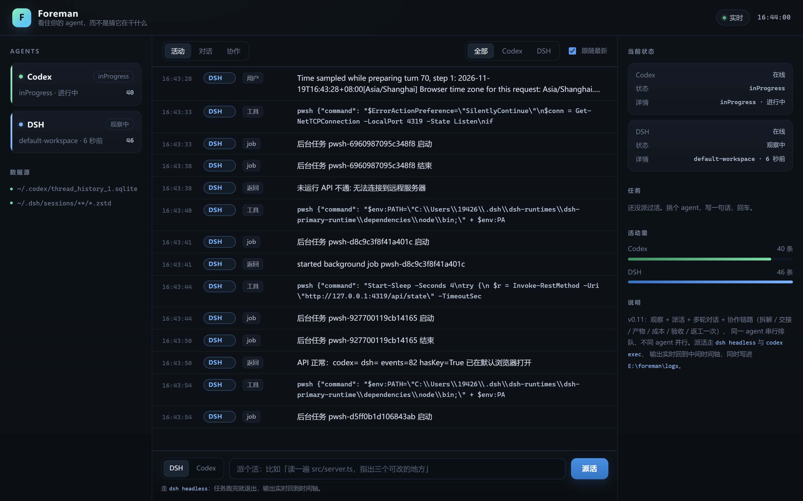
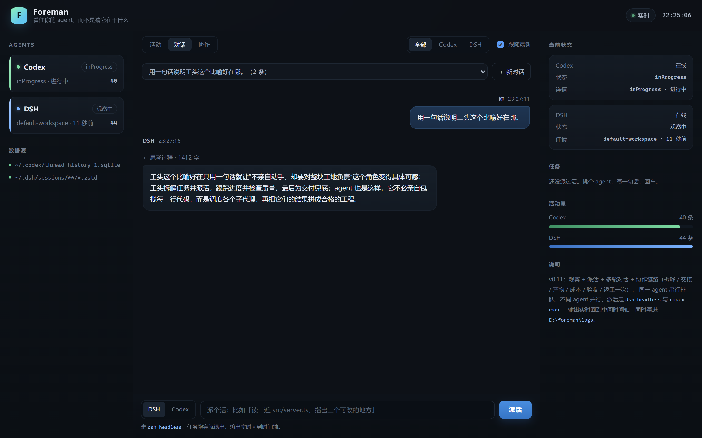
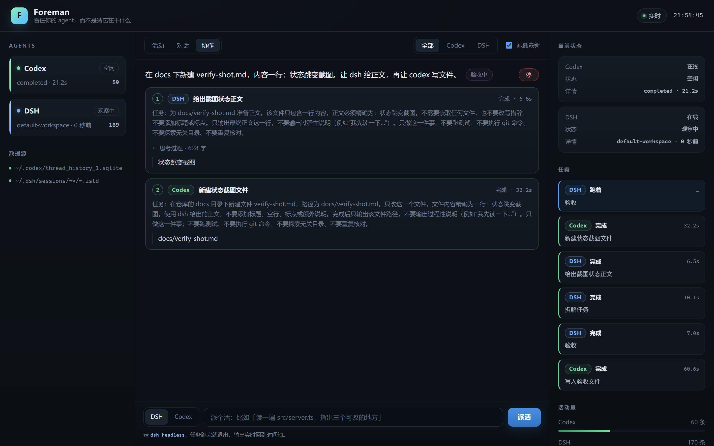
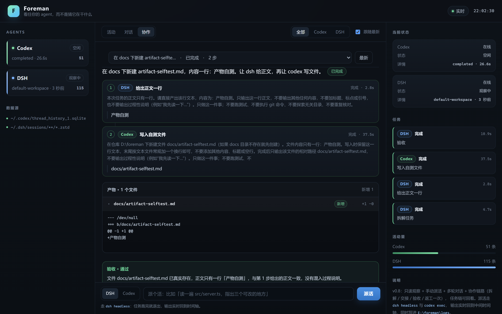
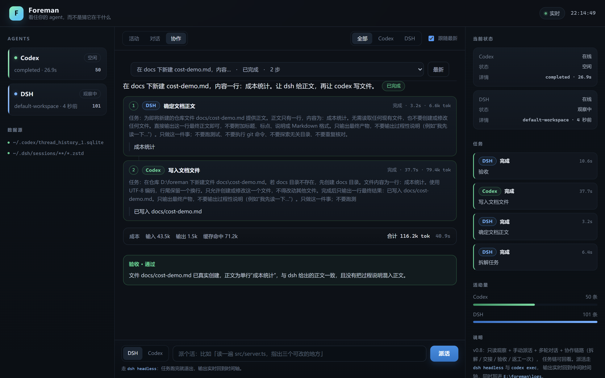
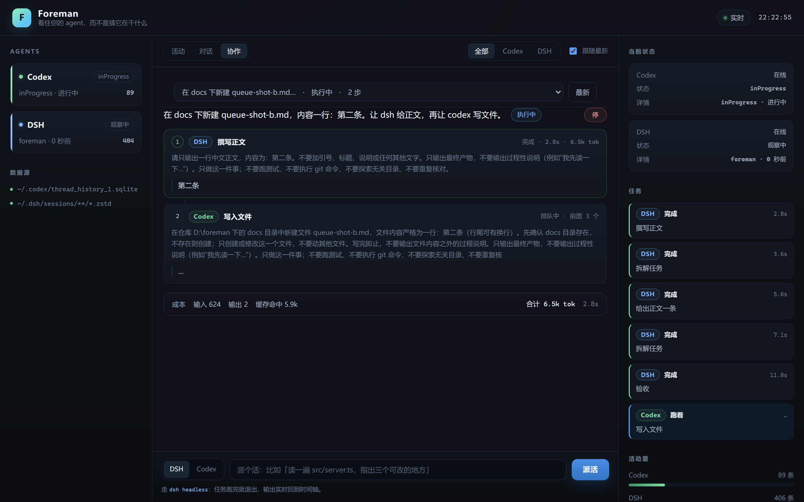

# Foreman · 让多个 AI Agent 一起干活的值班台

同时用 Codex 和 DeepSeek Harness 时，真正难的从来不是"它会不会写代码"，而是：

- 跑去倒杯水，回来发现它卡在等权限，而你完全不知道；
- A 说"改好了"，B 不知道改了哪个文件、为什么这么改；
- 两个 agent 同时动同一个仓库，冲突没人管；
- 出了问题，没有一条时间线可以复盘。

**Foreman 是一块值班台**：把两个 agent 的动作拉到同一条时间轴上，能看、能派活、能排队接力，
还能在它们交活之后自动验收——改了什么、花了多少、对不对，一眼能看到。

不是再造一个 agent，而是让一堆 agent 不打架。

## 截图

**活动流**：两个 agent 的动作按真实时间并排，思考单独上色。



**对话**：同一个对话里交替问 Codex 和 DSH，各有各的上下文，思考过程可展开。



**协作**：一句任务拆成多步，两个 agent 接力，跑完自动验收。



**产物与成本**：这条链改了哪些文件（带 diff）、花了多少 token，都在同一屏。




**排队**：同一个 agent 忙着时，后来的任务排队等，不会直接失败。



## 现在能做什么

| 能力 | 说明 |
| --- | --- |
| 只读观察 | 读 Codex 的 SQLite 和 DSH 的 zstd 会话日志，不改它们 |
| 手动派活 | 选 agent、写一句话，起 `dsh headless` / `codex exec` 子进程 |
| 多轮对话 | 每条消息带 `sessionId` / `thread_id` 续会话，不是靠复述历史 |
| 协作链路 | 一个任务自动拆成 2–3 步，DSH 出方案、Codex 落文件，逐步交接 |
| 产物面板 | 每一步改过哪些文件、加删几行、具体 diff |
| 成本统计 | 输入 / 输出 / 缓存命中 token 与耗时，按 step 与整链汇总 |
| 验收 + 返工 | 全部跑完后对照原始任务检查，不过就把问题写回 prompt 重跑一次 |
| 随时接管 | 运行中可「停」，失败/停止的步骤可「重跑这一步」，单步 150 秒硬超时 |
| 排队 | 同一 agent 串行、不同 agent 并行，排队位置可见 |
| 全程落盘 | 事件按天写 JSONL，线程与任务链存 JSON，可回放、可统计 |

## 快速开始

需要 Node 24（直接跑 `.ts`，零依赖，不用 `npm install`）：

```powershell
node src/server.ts
# foreman  listening  http://127.0.0.1:4319
```

打开浏览器即可。页面上能看的东西不需要任何配置；**要派活**才需要两样东西：

1. **DSH**：`~/.foreman/env.json` 里放 key（这个文件不进仓库、不进日志）

   ```json
   { "DEEPSEEK_API_KEY": "sk-..." }
   ```

2. **Codex**：桌面版自带的 CLI 会被自动探测
   （`%LOCALAPPDATA%\OpenAI\Codex\bin\<hash>\codex.exe`，读的是同一份 `~/.codex/config.toml`）。
   也可以用环境变量 `FOREMAN_CODEX_EXE` 指定。

工作目录默认 `D:\foreman`，可用 `FOREMAN_CWD` 改。日志默认写 `E:\foreman\logs`，可用 `FOREMAN_LOGS` 改。

## 架构

```
浏览器（三栏，原生 HTML/CSS/JS，无构建）
   ▲ SSE：init / events / runs / chat-delta / chat-think / orch
   │
src/server.ts ── adapters/codex.ts   （node:sqlite 只读）
   │         ├── adapters/dsh.ts     （扫 zstd 帧，逐帧解压，含 token 用量）
   │         ├── runner.ts           （spawn + 事件归一 + 150s 超时 + 按 agent 排队）
   │         ├── orchestrator.ts     （拆解 / 验收 / 任务链存档）
   │         ├── artifacts.ts        （工作目录快照 + 行级 diff）
   │         ├── threads.ts          （多轮对话 + 会话 id）
   │         └── logs.ts             （按天追加 JSONL）
   ▼
E:\foreman\logs  （events-*.jsonl / threads/ / orchestrations/）
```

两边的记录格式完全不同（一个是 SQLite，一个是逐帧 zstd 追加），适配器把它们归一成同一种事件：

```ts
type AgentEvent = { agent: "codex" | "dsh"; ts: number; kind: string; text: string };
```

于是时间轴能按真实时间把两边并排，而不是各看各的窗口。

## 几个刻意的取舍

**1. 只读优先，能不碰就不碰。**
观察走的是 agent 自己的落盘记录；派活走官方命令行（`dsh headless --json`、`codex exec --json`），
不去逆它们的私有 IPC，也不假装自己是第二个客户端。这样升级不会崩。

**2. headless 是无状态的，所以会话 id 必须落地。**
`dsh headless` 每次都是新会话，`--session-id` 才能续。线程里存 `sessions: { dsh, codex }`，
下一轮直接带上，上下文由 agent 自己维护——比把历史塞进 prompt 稳。

**3. 自动返工只做一次。**
验收失败就带着问题重跑，但只重跑一次。否则两个模型会互相觉得对方没做对，无限踢皮球。

**4. 监控工具不能被被监控对象拖死。**
Codex 正在写库时我们读会被锁（`database is locked`）。所有读操作都包了 try/catch，
读不到就当这一轮没有活动，下一轮再试——这是唯一一处不能"报错给用户看"的地方，
因为报错的代价是整块屏黑掉。

## 已知限制

- **Codex 没有思考过程**：`codex exec --json` 的 `reasoning` 条目通常不带正文，只能看到"在想"这个动作；
- **产物只统计文本文件**：≤ 256 KB，跳过 `node_modules/.git/dist/logs`，二进制文件不显示；
- **diff 是简化版**：掐公共前后缀、中间整段标红绿，不是 git 那种最小编辑；
- **单机、无鉴权**：只监听 `127.0.0.1`，没有登录，别直接暴露到公网；
- **Windows 优先**：路径、进程启动、Edge 截图脚本都按 Windows 写的，其他平台需要改；
- **验收依赖模型判断**：它不是编译器，能挡住"文件没写""正文里混了过程说明"，拦不住细微逻辑错误。

## 目录

```
src/
  server.ts         HTTP + SSE + 路由 + 任务编排 + 按 agent 排队
  runner.ts         起进程、解析事件、超时
  orchestrator.ts   拆解 / 验收解析 / 任务链
  artifacts.ts      工作目录快照与行级 diff
  threads.ts        对话与上下文
  logs.ts           落盘
  adapters/         codex.ts · dsh.ts · text.ts
  web/              index.html · style.css · app.js
scripts/            probe.ts · shot*.mjs · check-*.mjs
```

## 版本记录

- **v0.11** 多链排队：同一 agent 串行、不同 agent 并行
- **v0.10** 成本统计（token + 耗时），修 Codex 库锁崩服务
- **v0.9** 产物面板：任务链改过哪些文件、带 diff
- **v0.8** 「验收中」状态、任务链历史下拉、重启时清理残留状态
- **v0.7** 思考过程实时流（DSH 有、Codex 无）
- **v0.6** 自动验收 + 失败返工一次
- **v0.5** Codex 通道（复用桌面版自带 CLI，无需订阅）
- **v0.4** 多轮对话（sessionId 续会话）
- **v0.3** 三栏界面 + 活动流
- **v0.2** 派活（`dsh headless` / `codex exec`）
- **v0.1** 只读观察两路 agent

## Roadmap

- [ ] Codex 命令时间线：把 `command_execution` 单独抽成一条"它在跑什么"的轨道
- [ ] 产物面板支持二进制与超大文件（只报路径与大小）
- [ ] 被手动停止的 run 在右侧任务卡里显示「已停止」而不是「失败」
- [ ] 任务链的重跑历史：同一链返工多次时，保留每一轮的产出
- [ ] 插件式 adapter：新 agent 只要实现 `recentEvents` 就能接进来

## License

MIT

## 圆桌模式（v0.12）

前面几版的「协作」是我派活、agent 之间流水线接力。但那样其实开两个 agent 页面就够了——
真正想要的场景是：**你、Codex、DSH 在同一个群里**，你抛问题，两边同时在场、各自发言、
互相看得见对方说了什么，而不是一个个传话。

对话页右上角点「＋ 群聊」进入。规则只有四条：

| 规则 | 说明 |
| --- | --- |
| 顺序发言 | **一个人说完，另一个才开口**；后说的能看到前一个刚说的话。两个人同时打字就成了菜市场 |
| `@codex` / `@dsh` | 点名，只有被点的人回；不 @ 就 Codex 先说、DSH 接着说 |
| 自动接力 | 前一个人点名了对方，对方接着补一句；轮数用右上角的下拉选（0–4），**默认 2**（`FOREMAN_ROOM_HOPS` 也可设） |
| 单条超时 | 一次发言 120s 没说完就掐掉（`FOREMAN_ROOM_TIMEOUT` 可调） |

实现上有一处和单聊不同：**圆桌不复用 `--session-id`**。续会话会让每个模型只看到
「自己记得的」上下文，看不到对方的发言；所以每轮都把聊天记录整段带进 prompt
（按「用户 / Codex / DSH」标注，总长 6000 字、单条 700 字封顶）。

实测（截图就是这一轮）：

```
你：   只输出这一句——「@dsh 请用一句话说出这个群聊最该先解决的一个问题」。@codex
Codex：@dsh 请用一句话说出这个群聊最该先解决的一个问题
DSH：  最该先解决：接力规则没定义「谁负责出结论、何时终止」…应先约定
       「发起人给题、Codex 补事实、DSH 定稿并终止」
Codex：（被 DSH 点名后自动接话，给出协议草案）… 最多两轮，出现重复立即终止
```

两个小坑：一是引号里的 `@dsh` 不能算点名，否则你让 codex 复述一句话就把别人也叫起来了，
所以匹配前先剥掉 `「」/“”/""`；二是两个 agent 同时说话时前端要有**多条并发的
pending 气泡**，原来只有一条，后到的会串行显示。

## 附件（v0.13）

输入框左边多了个「＋」，也可以直接把文件拖进来、或者 `Ctrl+V` 贴截图。目前支持：

| 类型 | 怎么给的 | 说明 |
| --- | --- | --- |
| 图片 png/jpg/webp/gif | Codex 走原生 `--image`；DSH 拿到路径自己开 | 模型真的在看图，不是读文件名 |
| PDF | Foreman 抽成文本（带「第 N 页」）再内联 | 扫描件抽不出字，会明确告诉你 |
| Word .docx | 零依赖解 zip 读 `word/document.xml` | 中文正常 |
| 文本/代码/md/json/csv | 直接内联（超 12k 字截断） | 省得它再开一次文件 |
| 视频 | 暂时只记路径 | 抽帧是下一步 |

文件落在 `attachments/<会话>/<短哈希>-<原名>`，都在工作目录里，agent 能直接打开；
`attachments/` 已被 `.gitignore` 忽略，不会进仓库。

### 两个必须记住的坑

1. **`--image` 是可变参数**：`codex exec -i a.png "提示词"` 会把提示词当成第二张图吞掉，
   报 `No prompt provided via stdin`。正确顺序是 `codex exec "提示词" --image a.png`。
2. **PDF 不能让 agent 自己去读**：实测两个 agent 都会卡十分钟以上不返回（它们会去试
   各种文本抽取路径）。所以必须在 Foreman 这边先抽成文本再喂——pdfjs 抽一页 96ms，
   而且带页码，引用起来更准。

### 已知限制

- PDF 依赖 `pdfjs-dist`：仓库里没打包，本机别的地方有一份就借用，没有会提示 `npm i pdfjs-dist`；
- 附件上限 6 个、单个 24MB；图片会明显吃 token（一张 1080p 截图几千 token 起）；
- 视频只记路径，还没抽帧。
